# SUPERB Pareto Plan — Release Truth Hardening, the Coverage-Channel Story, and the Docs Long Tail (2026-11-08 08:50)

> **Input:** `TODO_LIST.md` (rebuilt 2026-11-08, 55 open rows, all verified) +
> the §f tails of the freshest reports (the 2026-11-08 08:34 audit report, the
> 2026-10-12 v1.15.0 train report, the annotated 09-23/09-28/09-30 reports now
> in `docs/status/archived/`) + ROADMAP Open questions. Every open row is
> folded into the tables below — nothing dropped. **Operator-gated actions are
> marked 🔒** (tag/branch-protection/config changes, external forks, comms).

## Context (why this plan looks like this)

This week taught three expensive lessons: the v1.15.1 tag shipped with a stale
stamp and sat red for 4 days (TWICE-run incident class — v1.14.0 did it first);
the sibling tags went out without the stress gate on a no-delta rationale; and
the docs corpus carried 327 pre-canon unharvested items that no gate saw until
the docs-gates battery was adopted. The Pareto chain below is a dependency
chain, not a value sort: **stamp truth → release-run trust → consumer-facing
story → automation → long tail.**

## Step 1 — Pareto breakdown

| Tier     | Tasks (of 42) | Share | Cumulative value | Why                                                                                                                                                                                                                     |
| -------- | ------------- | ----- | ---------------- | ----------------------------------------------------------------------------------------------------------------------------------------------------------------------------------------------------------------------- |
| **1%**   | T1–T2         | 2     | **~51%**         | The pre-tag stamp gate kills the twice-run "tag ships stale, master burns red for days" class at creation time; the cosign diagnosis restores trust in the Latest release's workflow. Two small tasks, half the outcome. |
| **4%**   | T1–T8         | 8     | **~64%**         | + the consumer-facing truth cluster: benchmark evidence read, pkg.go.dev verified, the CI release gate, and the complete coverage-channel story (guide + README + ADR #20 + examples).                                   |
| **20%**  | T1–T18        | 18    | **~80%**         | + the whole release-integrity automation: compare-link gate, lychee token, release-train.sh, erraudit migration + upstream, CLI FR delegation, compare-ref sets, api-stability sweep, watchdog/alerting, procedure truth. |
| **last** | T19–T42       | 24    | **→100%**        | Owner decisions (🔒), docs tails, hygiene, corpus drain program, launch track.                                                                                                                                          |

## Step 2 — Comprehensive plan (30–100 min each, 42 tasks, ALL TODOs)

Sorted by impact ÷ effort (customer-value first). 🔒 = operator-gated.
**Evidence source** = the TODO_LIST row this task closes.

| #   | Task                                                                                                                                                            | Tier | Impact | Effort | Closes (TODO_LIST)                          |
| --- | ---------------------------------------------------------------------------------------------------------------------------------------------------------------- | ---- | ------ | ------ | --------------------------------------------- |
| T1  | Pre-tag stamp gate: script that asserts version.go == the intended tag name BEFORE the ref exists + preflight wiring + selftest                                  | 1%   | Crit   | 90m    | (new — the v1.14.0+v1.15.1 incident class)    |
| T2  | Diagnose the v1.15.1 Release-run cosign-action failure (run 41863470480); fix the input or pin the version                                                       | 1%   | High   | 60m    | cosign-diagnose row                           |
| T3  | Read the CI benchmark job numbers vs `benchmarks/baseline.txt`; record the verdict (RunDetect touched every detect path)                                          | 4%   | High   | 45m    | bench-numbers row                             |
| T4  | pkg.go.dev render checks: core v1.15.1 + analysis/toolsdk/cmd pages; `/fetch` re-trigger if 404                                                                   | 4%   | High   | 30m    | pkg.go.dev row                                |
| T5  | CI release gate job: `go install cmd@vX.Y.Z` + `--version` smoke + stamp-vs-tag comparison                                                                        | 4%   | High   | 90m    | CI-release-gate row                           |
| T6  | `docs/guides/detector-coverage.md` — DetectorV2/DetectResult/RunDetect/AddDetectResult + v1-fallback contract                                                     | 4%   | High   | 90m    | detector-coverage-guide row                   |
| T7  | README coverage-channel selling + ADR #20 (docs/architecture-decisions.md)                                                                                        | 4%   | High   | 60m    | README-sell row + ADR row                     |
| T8  | DetectorV2 runnable example (root `examples/` + `pipeline/examples/`) + `example_compile_test.go` wiring                                                           | 4%   | Med    | 60m    | detectorv2-example row                        |
| T9  | `scripts/verify-compare-links.sh` (authenticated `gh api` per compare pair) + preflight wiring                                                                    | 20%  | High   | 90m    | verify-compare-links row                      |
| T10 | lychee `GITHUB_TOKEN` in ci.yml — or exclude `compare/` links and rely on T9 (pick ONE)                                                                           | 20%  | High   | 45m    | lychee-token row                              |
| T11 | `scripts/release-train.sh` skeleton + post-release verifier (proxy ×5, clean-dir `go get` ×5, assets, pkg.go.dev backoff, stamp check)                            | 20%  | Med    | 100m   | release-train.sh row                          |
| T12 | erraudit T13/T14 migration onto tagged analysis/pipeline APIs                                                                                                     | 20%  | High   | 100m   | erraudit-migration row                        |
| T13 | File the upstream erraudit `nolint-audit` false-stale issue + decide the CI-wirable path (public repo vs vendored binary)                                         | 20%  | High   | 60m    | upstream-issue row + erraudit-CI row          |
| T14 | CLI: delegate `flightRecorderFileConfig.resolve()` to `pipeline.ResolveFlightRecorderConfig`; unify duration-error wording                                        | 20%  | Med    | 45m    | CLI-FR-delegation row                         |
| T15 | Complete compare-ref sets in `analysis/CHANGELOG.md` + `cmd/go-finding/CHANGELOG.md`; verify toolsdk's                                                           | 20%  | Med    | 30m    | compare-ref-sets row                          |
| T16 | api-stability-report.md: add DetectorV2/DetectResult/RunDetect/AddDetectResult identifiers                                                                        | 20%  | Med    | 30m    | api-stability row                             |
| T17 | CI-event watchdog (assert a run per pushed SHA) + red-master alerting hook                                                                                        | 20%  | Med    | 60m    | watchdog row + red-master row                 |
| T18 | release-procedure.md truth pass: phased-CI-red reality, push→verify→tag order, **stress-on-sibling-tags rule**, files-to-gates map, GoReleaser recovery recipe, interrupted-train note | 20% | High | 90m | release-procedure row (+ d/1 disclosure)      |
| T19 | 🔒 Phase-aware `version-check`/`version-drift` OR documented tag-on-structural-red exception (decision + impl)                                                    | last | High   | 90m    | phase-aware row (owner decision)              |
| T20 | 🔒 Toolsdk versioning policy: independent vs lockstep; fix preflight's lockstep assumption accordingly                                                             | last | High   | 60m    | toolsdk-policy row (owner decision)           |
| T21 | 🔒 Dependabot gomod config collapse to `/` + investigate the failed scheduled run (36348692826)                                                                   | last | Med    | 45m    | dependabot-config row + investigation row     |
| T22 | 🔒 Branch protection: fix required-context vs matrix-job-name mismatch (wrapper jobs or expanded names)                                                           | last | Med    | 45m    | context-mismatch row                          |
| T23 | 🔒 codecov branch (open PR or delete) + launch-comms mode decision (announcement refresh vs quiet-maintenance)                                                    | last | Med    | 30m    | codecov row + launch-comms OQ                 |
| T24 | Migrate the two goreleaser deprecations (`brews`, `archives.format_overrides.format`)                                                                             | last | Med    | 60m    | goreleaser-deprecations row                   |
| T25 | Render-verify the nix pipe during the next train, then drop `--skip=nix` (blocked on a train)                                                                     | last | Low    | 30m    | render-verify row                             |
| T26 | ecosystem.md fresh sweep + consumer-count audit refresh                                                                                                           | last | Low    | 60m    | ecosystem row + consumer-count row            |
| T27 | CLI surfaces `Summary.FilesScanned`/`SkippedModules` (column or flag)                                                                                             | last | Med    | 60m    | CLI-coverage row                              |
| T28 | Consumer bumps batch (per-repo; gomend/licenseforge stay blocked)                                                                                                 | last | Low    | 60m    | consumer-bumps row                            |
| T29 | SARIF round-trip property/fuzz test                                                                                                                               | last | Med    | 60m    | sarif-round-trip row                          |
| T30 | shellcheck: flake devShell entry + scripts/ gate (fix whatever it flags)                                                                                          | last | Low    | 45m    | shellcheck row                                |
| T31 | Boundary READMEs for `docs/feedback/` + `docs/research/`                                                                                                          | last | Low    | 30m    | boundary-readmes row                          |
| T32 | seed_N convention documented in AGENTS + fuzz-seed cost measurement + curated-vs-raw policy                                                                       | last | Low    | 30m    | seed doc + seed-cost rows                     |
| T33 | go.work.sum freshness gate                                                                                                                                        | last | Low    | 30m    | gowork-sum row                                |
| T34 | Consumer-compat-at-HEAD CI variant (catch API drift before a train)                                                                                               | last | Low    | 60m    | consumer-compat-at-head row                   |
| T35 | Version-lattice guard script (coherent tag/module lattice pre-train)                                                                                              | last | Low    | 60m    | version-lattice row                           |
| T36 | Per-module lint flake view (one surface for 5 lint jobs)                                                                                                          | last | Low    | 45m    | lint-flake row                                |
| T37 | Diet AGENTS.md under 220 lines (after T18 lands the war-story distillation); memory-loss check per cut                                                            | last | Med    | 100m   | AGENTS-diet row                               |
| T38 | 🔒 Corpus drain batch 1: sampled annotate-resolve of April-era archived reports (XL program, repeat per batch; ratchet 340 ↓)                                     | last | Low    | 100m   | corpus-backlog row                            |
| T39 | 🔒 LAUNCH3 (Awesome Go fork+PR) + LAUNCH4 (homebrew tap repo + token) prep                                                                                        | last | Med    | 45m    | LAUNCH3/LAUNCH4 rows                          |
| T40 | CONTRIBUTING / public release-runbook page (from the T18 procedure)                                                                                               | last | Low    | 100m   | CONTRIBUTING row                              |
| T41 | v2.0 design spike agenda (Position sentinel, FixStrategy union, TagSet, sub-structs)                                                                              | last | Low    | 60m    | v2.0-spike row                                |
| T42 | Hygiene batch: buildcache prune policy + gopls SA1012 noise + ROADMAP provenance triage + standing watches (#74, dependabot, erraudit upstream)                   | last | Low    | 30m    | hygiene rows (4)                              |

## Step 3 — Detailed breakdown (≤12 min each, ALL TODOs)

Execution rank = strict work order within dependency limits. 🔒 = operator.

| Rank | ID     | Task (≤12 min)                                                                                                   | Depends    |
| ---- | ------ | ------------------------------------------------------------------------------------------------------------------ | ---------- |
| 1    | F1.1   | Read release-preflight.sh + ci.yml tag jobs; place the stamp check (T1 design)                                     | —          |
| 2    | F1.2   | Write `scripts/stamp-gate.sh`: arg = intended tag name; asserts version.go == name; OK/FAIL verdict lines          | 1          |
| 3    | F1.3   | Prove the FAIL path: run with `v1.15.2` against today's 1.15.1 → exit 1 (dead-gate rule)                           | 2          |
| 4    | F1.4   | Wire into release-preflight.sh tag-prep stage + document in release-procedure.md                                   | 2          |
| 5    | F1.5   | Selftest injection class: stale-stamp fixture asserts the exact FAIL line                                          | 3          |
| 6    | F1.6   | Commit + push; verify CI structural job picks it up                                                                | 4          |
| 7    | F2.1   | Pull run 41863470480's cosign step logs; identify the exact validation error                                       | —          |
| 8    | F2.2   | Check the action input + cosign version resolved in the workflow vs the local one                                  | 7          |
| 9    | F2.3   | Fix: pin the cosign version or correct the input; actionlint clean                                                 | 8          |
| 10   | F2.4   | Prove on a scratch tag dispatch (workflow_dispatch dry path) — verdict line                                        | 9          |
| 11   | F3.1   | Locate the v1.15.x CI runs' benchmark job; extract the numbers table                                               | —          |
| 12   | F3.2   | `bash scripts/bench-compare.sh benchmarks/baseline.txt <extracted>`; read allocs AND time                           | 11         |
| 13   | F3.3   | Record the verdict in benchmarks/README (or file a regression row if red)                                          | 12         |
| 14   | F4.1   | Fetch core v1.15.1 pkg.go.dev page; record render status                                                           | —          |
| 15   | F4.2   | Fetch pipeline/analysis/toolsdk/cmd pages; `/fetch` re-trigger any 404; wait+recheck once                          | 14         |
| 16   | F4.3   | Close the TODO row with per-page evidence (scope-honest wording)                                                   | 15         |
| 17   | F5.1   | Draft the release-gate job YAML (install + `--version` + stamp-vs-tag assert)                                      | —          |
| 18   | F5.2   | Add to release.yml post-tag stage with a runner-runtime budget line                                                | 17         |
| 19   | F5.3   | actionlint + first live proof on the next tag (or dispatch dry)                                                    | 18         |
| 20   | F6.1   | Outline detector-coverage.md: API table, v1-fallback contract, host integration                                   | —          |
| 21   | F6.2   | Write the API reference section (DetectResult/DetectorV2/RunDetect/AddDetectResult)                                | 20         |
| 22   | F6.3   | Write the host-integration section (AddDetectResult → Summary flow)                                                | 21         |
| 23   | F6.4   | Link from README docs table + FEATURES row; docs-api-check + dprint green                                          | 22         |
| 24   | F7.1   | README "Why" blurb: the coverage-channel paragraph (did the tool SEE every file?)                                  | —          |
| 25   | F7.2   | README short DetectorV2 snippet (front page, ≤10 lines)                                                            | 24         |
| 26   | F7.3   | Write ADR #20 in docs/architecture-decisions.md (context/decision/consequences)                                    | —          |
| 27   | F7.4   | Link ADR #20 from FEATURES coverage rows; gates green                                                              | 26         |
| 28   | F8.1   | Write `examples/detectorv2/main.go` (v2 detector + RunDetect + AddDetectResult)                                    | —          |
| 29   | F8.2   | Mirror in `pipeline/examples/`; add both to example_compile_test.go                                                | 28         |
| 30   | F8.3   | `go test ./examples/...` + full gates; commit                                                                      | 29         |
| 31   | F9.1   | Write `scripts/verify-compare-links.sh` (gh api per pair, OK/FAIL verdict)                                         | —          |
| 32   | F9.2   | Prove FAIL path: inject a bogus pair → exit 1                                                                      | 31         |
| 33   | F9.3   | Wire into release-preflight + release-procedure.md pre-push checklist                                              | 31         |
| 34   | F10.1  | Add `GITHUB_TOKEN` env to the lychee step in ci.yml (rate-limit class killed)                                      | —          |
| 35   | F10.2  | OR: exclude `compare/` from lychee (choose ONE path with T9 owner); actionlint                                     | 34         |
| 36   | F10.3  | Watch one green markdown-link-check run; record run id                                                              | 35         |
| 37   | F11.1  | `scripts/release-train.sh` stage skeleton (prep→verify→tag→push→rerun→resync→postflight)                           | T9,T10     |
| 38   | F11.2  | Post-release verifier: proxy ×5, clean-dir `go get` ×5, assets listing, stamp check                                | 37         |
| 39   | F11.3  | Selftest (dry mode) + link from release-procedure.md                                                               | 38         |
| 40   | F12.1  | Read erraudit's T13/T14 API expectations; list the Edits-bridge call sites                                         | —          |
| 41   | F12.2  | Migrate T13 (analysis API) onto the tagged version; tests green                                                    | 40         |
| 42   | F12.3  | Migrate T14 (pipeline API) onto the tagged version; tests green                                                    | 41         |
| 43   | F12.4  | Cross-repo verify via `gh -R`; record the migration commit hashes                                                  | 42         |
| 44   | F13.1  | Draft the upstream `nolint-audit` false-stale issue (24/24 evidence from AGENTS)                                   | —          |
| 45   | F13.2  | File via `gh -R`; cross-link from AGENTS gotcha                                                                    | 44         |
| 46   | F13.3  | Decide erraudit CI path (public repo request vs vendored binary); write the decision down                           | 45         |
| 47   | F14.1  | CLI `flightRecorderFileConfig.resolve()` → call `pipeline.ResolveFlightRecorderConfig`                             | —          |
| 48   | F14.2  | Delete the mirrored parser; unify duration-error wording; pin with a test                                          | 47         |
| 49   | F14.3  | GOWORK=off cmd build + tests; commit                                                                               | 48         |
| 50   | F15.1  | Add `[Unreleased]`+version compare refs to analysis/CHANGELOG.md (13-ref pattern from pipeline)                    | —          |
| 51   | F15.2  | Same for cmd/go-finding/CHANGELOG.md; verify toolsdk's single ref set                                              | 50         |
| 52   | F15.3  | link-check + dprint green; commit                                                                                  | 51         |
| 53   | F16.1  | Add the 4 identifiers to docs/api-stability-report.md (pipeline surface section)                                   | —          |
| 54   | F16.2  | Cross-check FEATURES rows vs report entries; gates green                                                           | 53         |
| 55   | F17.1  | Script `scripts/ci-watchdog.sh`: push SHA → assert run exists (the 10-01 f394f54 class)                            | —          |
| 56   | F17.2  | Red-master alerting: scheduled check + notification hook (or GH native); prove both paths                          | 55         |
| 57   | F17.3  | Wire watchdog into pre-push-verify (post-push step); commit                                                        | 56         |
| 58   | F18.1  | release-procedure.md: "Phased CI red" section (what is expected-red at each train phase)                           | —          |
| 59   | F18.2  | release-procedure.md: push→verify→tag ordering + stress-on-sibling-tags rule (the d/1 rule)                        | 58         |
| 60   | F18.3  | release-procedure.md: files-to-gates map + local-GoReleaser recovery recipe                                         | 59         |
| 61   | F18.4  | release-procedure.md: interrupted-train note; AGENTS war-stories → one-line pointers (diet prep)                   | 60         |
| 62   | F19.1  | 🔒 Owner decision: phase-aware gates vs documented exception (record in ROADMAP OQ or procedure)                   | —          |
| 63   | F19.2  | Implement per the decision (gate `--phase` flag or procedure paragraph); prove both paths                          | 62         |
| 64   | F20.1  | 🔒 Owner decision: toolsdk independent vs lockstep (record)                                                        | —          |
| 65   | F20.2  | Implement: preflight tag-map config OR toolsdk fold-in checklist                                                   | 64         |
| 66   | F21.1  | 🔒 Dependabot: collapse gomod entries to `/` (or keep-4 decision recorded)                                         | —          |
| 67   | F21.2  | Investigate scheduled "Dependabot Updates" run 36348692826; record the cause                                        | 66         |
| 68   | F22.1  | 🔒 Branch protection: list required contexts vs actual job names; pick the fix shape                               | —          |
| 69   | F22.2  | Apply (wrapper jobs or expanded names); verify a dependabot-style PR can satisfy it                                 | 68         |
| 70   | F23.1  | 🔒 codecov branch: open the PR or delete the ref; record which                                                     | —          |
| 71   | F23.2  | 🔒 Launch-comms mode decision; refresh or park the announcement draft accordingly                                   | 70         |
| 72   | F24.1  | Migrate `brews` section to the current goreleaser schema                                                           | —          |
| 73   | F24.2  | Migrate `archives.format_overrides.format`; `goreleaser check` clean; commit                                       | 72         |
| 74   | F25.1  | (next train) Render the nix pipe; attach the formula to the run evidence                                           | train      |
| 75   | F25.2  | Drop `--skip=nix` from the local procedure; document                                                              | 74         |
| 76   | F26.1  | ecosystem.md: fresh consumer sweep (recount, table, date stamp)                                                    | —          |
| 77   | F26.2  | Update the AGENTS consumer-count note with the new number                                                          | 76         |
| 78   | F27.1  | CLI: decide column vs flag for FilesScanned/SkippedModules; implement                                              | —          |
| 79   | F27.2  | Output-golden test update; docs touch; commit                                                                      | 78         |
| 80   | F28.1  | Consumer bumps: pick the two freshest leads; bump + build each                                                     | —          |
| 81   | F28.2  | Record per-consumer state in ecosystem.md; push                                                                    | 80         |
| 82   | F29.1  | Write the SARIF round-trip property test (export→import→Equal)                                                     | —          |
| 83   | F29.2  | Wire into the test suite; flake-check clean; commit                                                                | 82         |
| 84   | F30.1  | shellcheck in flake devShell + a scripts/ gate step                                                                | —          |
| 85   | F30.2  | Fix every shellcheck finding it raises (expect ≤10); gates green                                                   | 84         |
| 86   | F31.1  | docs/feedback/README.md + docs/research/README.md boundary notes                                                   | —          |
| 87   | F31.2  | link-check + dprint; commit                                                                                        | 86         |
| 88   | F32.1  | AGENTS testing section: seed_N promotion convention                                                                | —          |
| 89   | F32.2  | Measure the 145 seeds' test-time cost; record; policy decision in the fuzz row                                     | 88         |
| 90   | F33.1  | go.work.sum freshness gate script + structural-checks wiring                                                       | —          |
| 91   | F33.2  | Prove the FAIL path (tamper go.work.sum → exit 1)                                                                   | 90         |
| 92   | F34.1  | consumer-compat-at-HEAD variant (resolve modules from the workspace commit, not a tag)                             | —          |
| 93   | F34.2  | CI job wrapper + budget; first run verdict                                                                          | 92         |
| 94   | F35.1  | Version-lattice guard: assert tags/modules form a coherent lattice; preflight wiring                                | —          |
| 95   | F35.2  | Selftest injection (broken lattice → exact FAIL line)                                                              | 94         |
| 96   | F36.1  | Per-module lint flake view (job summary or merged report)                                                          | —          |
| 97   | F36.2  | Document in AGENTS testing/tooling section                                                                          | 96         |
| 98   | F37.1  | AGENTS diet: move the release war-stories pointers to release-procedure.md (post-T18)                              | T18        |
| 99   | F37.2  | Move the Key Files table to docs/ (keep pointers); memory-loss check per cut                                        | 98         |
| 100  | F37.3  | Re-count lines (target ≤220); gates green; commit                                                                   | 99         |
| 101  | F38.1  | 🔒 Corpus batch 1: sample 10 April reports; annotate-resolve their open items (emit-keys flow)                     | —          |
| 102  | F38.2  | Lower the audit_max ratchet by the resolved count; re-run battery                                                  | 101        |
| 103  | F39.1  | 🔒 LAUNCH3: fork awesome-go, open the PR from the finalized entry                                                   | —          |
| 104  | F39.2  | 🔒 LAUNCH4: create the tap repo + secret (or record the blocker)                                                    | 103        |
| 105  | F40.1  | CONTRIBUTING.md public page (from release-procedure + AGENTS practices)                                            | T18        |
| 106  | F40.2  | Link from README; link-check; commit                                                                               | 105        |
| 107  | F41.1  | v2.0 spike agenda doc (Position sentinel, FixStrategy union, TagSet, sub-structs; from ROADMAP Hardening)           | —          |
| 108  | F41.2  | Link from ROADMAP Hardening; commit                                                                                | 107        |
| 109  | F42.1  | Hygiene batch: buildcache prune policy line; gopls SA1012 decision; ROADMAP provenance triage; standing-watch notes  | —          |
| 110  | F42.2  | Final battery run + TODO_LIST row closings; commit + push                                                           | 109        |

## Execution graph

```mermaid
flowchart TD
    subgraph TIER1["1% → 51%"]
        T1["T1 Pre-tag stamp gate (F1.x)"]
        T2["T2 Cosign diagnosis (F2.x)"]
    end
    subgraph TIER4["4% → 64%: consumer-facing truth"]
        T3["T3 Bench numbers read (F3.x)"]
        T4["T4 pkg.go.dev checks (F4.x)"]
        T5["T5 CI release gate (F5.x)"]
        T6["T6 detector-coverage guide (F6.x)"]
        T7["T7 README sell + ADR #20 (F7.x)"]
        T8["T8 DetectorV2 examples (F8.x)"]
    end
    subgraph TIER20["20% → 80%: release-integrity automation"]
        T9["T9 verify-compare-links (F9.x)"]
        T10["T10 lychee token (F10.x)"]
        T11["T11 release-train.sh (F11.x)"]
        T12["T12 erraudit migration (F12.x)"]
        T13["T13 erraudit upstream + CI path (F13.x)"]
        T14["T14 CLI FR delegation (F14.x)"]
        T15["T15 compare-ref sets (F15.x)"]
        T16["T16 api-stability sweep (F16.x)"]
        T17["T17 watchdog + alerting (F17.x)"]
        T18["T18 release-procedure truth (F18.x)"]
    end
    subgraph LAST["→ 100%: decisions, docs, tail"]
        T19["T19 🔒 phase-aware gates"]
        T20["T20 🔒 toolsdk policy"]
        T21["T21 🔒 dependabot config"]
        T22["T22 🔒 protection contexts"]
        T23["T23 🔒 codecov + comms"]
        T24["T24 goreleaser deprecations"]
        T25["T25 nix-pipe render (needs train)"]
        T26["T26 ecosystem sweep"]
        T27["T27 CLI coverage surface"]
        T28["T28 consumer bumps"]
        T29["T29 SARIF round-trip"]
        T30["T30 shellcheck"]
        T31["T31 boundary READMEs"]
        T32["T32 seeds doc+cost"]
        T33["T33 go.work.sum gate"]
        T34["T34 compat-at-HEAD"]
        T35["T35 lattice guard"]
        T36["T36 lint flake view"]
        T37["T37 AGENTS diet"]
        T38["T38 🔒 corpus drain batches"]
        T39["T39 🔒 LAUNCH3/4"]
        T40["T40 CONTRIBUTING"]
        T41["T41 v2.0 spike agenda"]
        T42["T42 hygiene batch"]
    end
    T1 --> T18
    T2 --> T5
    T18 --> T11
    T9 --> T11
    T10 --> T11
    T6 --> T7
    T6 --> T8
    T7 --> T16
    T12 --> T13
    T18 --> T37
    T18 --> T40
    T19 --> T11
    T20 --> T35
    T38 --> T42
```

## Verschlimmbesser guards (do no harm)

1. **No tag pushes without the owner**; sibling-tag trains carry the stress
   gate or a WRITTEN no-op justification in the train log (the 2026-11-08
   d/1 rule — no silent rationalizations).
2. **No gate weakened to make a task pass** — every new gate proves its FAIL
   path once before it counts; ratchets only ever move DOWN (the audit_max
   340 pin may fall, never rise).
3. **No baseline regeneration without a failed-gate justification** recorded
   in `benchmarks/README.md`.
4. **CHANGELOG stays append-only**; archived reports get ANNOTATE-mode edits
   only; the living docs are the only rewritten surfaces.
5. **Version labels**: FEATURES must never claim a version beyond `version.go`
   (docs-api-check enforces); `(unreleased)` is the mid-cycle word.
6. **Daemon discipline**: commit units immediately with real messages; check
   `git status` BEFORE authoring any commit message (the 2026-11-08 d/2 rule).

## Annotation log (plan is a snapshot; annotate, never rewrite)

- 2026-11-08 08:50 — plan created from TODO_LIST @ the post-audit state
  (55 verified open rows) + the 2026-11-08 08:34 audit report §f + the
  annotated 09-23/09-28/09-30 report tails. Freshness-gate token alignment
  (§f rows ↔ TODO_LIST rows) verified by a full green battery run before
  this file was written.

_Assisted-by: Crush <crush@charm.land>_
